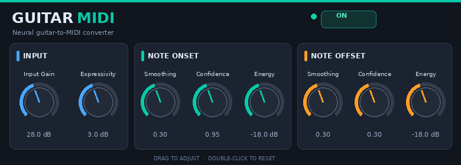

# GuitarMidi-LV2

**Polyphonic guitar-to-MIDI for piStomp and MODEP**



GuitarMidi-LV2 is an open-source LV2 plugin that converts audio from a conventional electric guitar into MIDI notes, supporting both single-note playing and polyphonic chord detection.

This independently maintained fork focuses on developing a practical, responsive and CPU-efficient guitar-to-MIDI solution for the **[piStomp](https://www.treefallsound.com/) platform and its MODEP plugin environment**, particularly the Raspberry Pi 5-based piStomp v3.

The goal is to improve the reliability, latency, performance and usability of guitar-to-MIDI conversion without requiring specialised guitar pickups, hexaphonic hardware or proprietary MIDI guitar equipment.

## Project origin and acknowledgements

**This repository is an independently maintained fork of [GuitarMidi-LV2](https://github.com/geraldmwangi/GuitarMidi-LV2), originally created by Gerald Mwangi of [Lodi Audio](https://www.lodi-audio.com/).**

The original project provides the foundational guitar-to-MIDI signal processing and neural network technology on which this fork depends.

Developing and training neural network models requires substantial time, expertise and computing resources. We gratefully acknowledge Gerald's work in creating GuitarMidi-LV2 and making this technology available to the open-source community.

This fork concentrates on improving and extending the technology for piStomp/MODEP and related LV2 environments while preserving recognition of its origins.

We also acknowledge the original project's use of the [SynthTab](https://synthtab.dev/) dataset and the contributors and tools credited by the upstream developer.

**This project is independently maintained and is not affiliated with, sponsored by or officially endorsed by Lodi Audio.** Support requests relating to this fork should be directed to this repository rather than the original developer.

### Supporting the original developer — ArtiString

Lodi Audio develops and sells **[ArtiString](https://www.lodi-audio.com/plugins/artistring)**, a commercial guitar-to-MIDI VST3 plugin built upon the GuitarMidi technology.

ArtiString is available for Windows and Linux and offers an enhanced user interface, real-time note visualisation, guitar-specific presets and additional features designed for musicians seeking a polished, supported guitar-to-MIDI solution.

Revenue from ArtiString helps fund the original research, neural network training and continued development of GuitarMidi-LV2.

**If you find this open-source technology valuable and would like to help support its continued development, please consider purchasing [ArtiString](https://www.lodi-audio.com/plugins/artistring).**

Supporting the original developer helps sustain the work that makes independent projects such as this fork possible.

For commercial licensing or collaboration enquiries, contact Lodi Audio at [info@lodi-audio.com](mailto:info@lodi-audio.com).

---

## Project goals

The primary objective is to provide a high-quality, usable guitar-to-MIDI plugin for live performance within the piStomp/MODEP environment.

Development priorities include:

- **Low latency:** Reduce the time between playing a guitar note and generating the corresponding MIDI event.
- **Efficient processing:** Minimise CPU usage while maintaining reliable real-time detection on Raspberry Pi hardware.
- **Polyphonic detection:** Recognise multiple simultaneous notes, including chords and double-stops.
- **Reliable MIDI behaviour:** Generate consistent Note On/Off messages, manage note states correctly and avoid stuck notes.
- **Expressive performance:** Investigate improvements for string bends, vibrato and other guitar techniques.
- **Integration:** Work reliably with MODEP's MIDI routing, effects and software instruments.
- **Open development:** Document, test and improve the implementation while preserving appropriate attribution and licensing.

The long-term aim is a practical guitar-to-MIDI system that feels responsive enough for live playing while making effective use of piStomp's processing resources.

## Current capabilities

The plugin currently provides:

- Polyphonic guitar note detection using the original neural network model.
- Standard electric guitar input through a conventional audio interface.
- MIDI Note On and Note Off generation.
- Configurable confidence and energy thresholds.
- Independent onset and offset smoothing controls.
- Velocity generation based on detected signal energy.
- TensorFlow Lite inference accelerated using XNNPACK.
- Asynchronous inference processing with an event-driven worker.
- CPU-efficient bypass handling.
- MIDI All Notes Off messages on bypass.
- Cross-platform LV2 builds.

### Platform support

| Platform | Status |
|---|---|
| Raspberry Pi 5 / piStomp v3 / MODEP | Primary development and testing platform |
| Windows x64 / MOD Desktop | Build and runtime tested |
| Linux x64 LV2 hosts | Build supported; broader runtime verification ongoing |

Although cross-platform builds are maintained for development and testing, **piStomp/MODEP remains the primary focus of this fork**.

## Performance and latency

A major development priority has been reducing CPU usage without sacrificing responsiveness.

### Event-driven inference

The original inference implementation used a busy-polling worker that consumed considerable CPU resources even when no new inference data was available.

This fork introduced event-driven inference using a single-producer/single-consumer queue and semaphore-based notifications. The inference worker now sleeps when there is no work to process.

Testing on Raspberry Pi 5 showed approximately:

| Configuration | Reported CPU usage |
|---|---:|
| Original busy-polling implementation | ~99% |
| Event-driven inference | ~23–24% |
| Plugin bypassed | ~2–5% |

These are measurements from the development environment, not universal performance guarantees.

The TensorFlow Lite interpreter and XNNPACK delegate remain initialised across bypass transitions, avoiding unnecessary resource recreation.

### Guitar-to-MIDI latency

A separate diagnostic utility, the [piStomp MIDI Latency Probe](https://github.com/tothoseofus/piStomp-MIDI-Latency-Probe), was developed to measure MIDI event timing directly against the original guitar audio without introducing synthesiser response latency.

Initial testing measured approximately:

- **36 ms median** guitar attack-to-MIDI Note On latency.
- Approximately **25–45 ms** between the 5th and 95th percentiles across the measured attacks.

Subsequent development improved model-output polling. A comparison of 80 matched Note On events using the same guitar test audio showed an average timing improvement of approximately **6.1 ms**.

These results depend on the test material, attack detection method, configuration and host environment. Further optimisation and verification are ongoing.

## How guitar detection works

GuitarMidi-LV2 combines digital signal processing and machine learning to identify notes from a conventional guitar audio signal.

The original detection architecture, created by Gerald Mwangi, uses a bank of Butterworth bandpass filters to extract frequency information associated with guitar notes and their harmonics.

The filtered signals are passed to a custom neural network that estimates which notes are being played.

### Signal processing pipeline

1. **Audio input:** Receive the guitar signal from an audio interface.
2. **Filter bank:** Apply frequency-selective filters corresponding to guitar notes and harmonics.
3. **Neural inference:** Analyse the filtered audio using a TensorFlow Lite model.
4. **Note detection:** Apply confidence thresholds, energy thresholds and smoothing.
5. **MIDI generation:** Produce MIDI Note On/Off events for connected instruments.

The neural network receives a representation consisting of 148 filtered signals across 256 time samples and produces confidence values for 37 possible notes.

The supported note range is defined by the original model and currently covers MIDI notes 40–76, corresponding approximately to E2–E5.

The existing model remains a central component of this fork. Future improvements may include changes to its surrounding signal processing and MIDI decision logic, or investigation of alternative detection methods.

## Installation

### piStomp / MODEP

Precompiled Raspberry Pi ARM64 builds are produced using GitHub Actions.

Check the [GitHub Releases](https://github.com/tothoseofus/GuitarMidi-LV2/releases) page for available packages.

For a manual installation, the compiled `guitarmidi.lv2` bundle must be placed in an LV2 directory accessible to the host. Installation and restart requirements depend on the piStompOS/MODEP configuration.

### Other platforms

Windows x64 and Linux x64 builds are also maintained for development and testing.

Refer to the available GitHub Actions artifacts or releases for platform-specific packages.

Not every host and operating-system combination has been tested.

## Using GuitarMidi-LV2

### Guitar setup

For best initial results:

1. Use a conventional electric guitar with standard tuning (E–A–D–G–B–E).
2. Connect the guitar to a suitable audio interface.
3. Use a clean, unprocessed guitar signal.
4. Avoid distortion, compression or effects before the guitar-to-MIDI processor during initial setup.
5. Begin with the bridge pickup as a reference, then experiment with pickup selection and input levels.

The input gain should provide a clear, strong signal without clipping. There is no single ideal interface gain setting for every guitar.

### MODEP signal routing

A typical pedalboard configuration is:

```text
Electric Guitar
      |
      v
Audio Interface
      |
      v
GuitarMidi-LV2
      |
      | MIDI output
      v
MIDI Synthesiser / Instrument
      |
      v
Audio Output
```

Connect the guitar audio input to GuitarMidi-LV2, then connect its MIDI output to a compatible software synthesiser or MIDI-processing plugin.

Start with individual notes and adjust the detection parameters until tracking is reasonably reliable. Then progress to intervals, double-stops and chords.

### Tuning detection

The plugin provides adjustable controls for balancing sensitivity against false triggers and missed notes.

A useful starting approach is:

1. Set a suitable input gain.
2. Play individual sustained notes.
3. Adjust onset confidence and energy thresholds to improve triggering.
4. Adjust offset thresholds to obtain reliable note releases.
5. Adjust smoothing to reduce jitter without making notes feel excessively delayed.
6. Test chords and faster playing.
7. Adjust expressivity to achieve a useful MIDI velocity range.

No single set of parameters is optimal for every guitar, pickup, playing style or synthesiser.

## Plugin parameters

The plugin exposes the following LV2 controls.

| Parameter | Range | Default | Purpose |
|---|---|---|---|
| Input Gain | −20 to +20 dB | 0 dB | Adjusts input level for detection |
| Expressivity Range | −3 to +20 dB | 7 dB | Adjusts the relationship between detected energy and MIDI velocity |
| Onset Smoothing | 0.0–0.9 | 0.8 | Smooths note-on confidence |
| Offset Smoothing | 0.0–0.9 | 0.3 | Smooths note-off confidence |
| Onset Confidence Threshold | 0.00–0.99 | 0.80 | Minimum confidence for triggering a new note |
| Offset Confidence Threshold | 0.00–0.99 | 0.10 | Confidence threshold used for note release |
| Onset Energy Threshold | −20 to +3 dB | 0.70 dB | Minimum signal energy for a new note |
| Offset Energy Threshold | −20 to +3 dB | −18 dB | Energy threshold used for note release |

Increasing smoothing generally reduces fluctuations but can make note transitions less responsive.

The confidence and energy thresholds should be tuned together for the best balance between reliable detection and unwanted MIDI events.

## Bypass behaviour

This fork implements support for the LV2 enabled/bypass control used by MODEP.

When bypassed:

- Audio analysis and new inference submissions are suppressed.
- The inference infrastructure remains initialised.
- Pending model results are discarded or invalidated.
- Internal note-detection state is reset.
- MIDI CC 123 (All Notes Off) is sent on all 16 MIDI channels when bypass begins.

These measures reduce idle CPU usage and help prevent notes from remaining active when the plugin is bypassed.

Note that CC 123 is channel-wide and may affect other MIDI sources sharing the same destination and channels.

## Known limitations

Guitar-to-MIDI conversion from a conventional mono guitar pickup is technically challenging, particularly when several strings sound simultaneously.

Current limitations include:

- **Note range:** Detection is limited to the 37 notes supported by the existing model.
- **False positives:** Strong harmonics and overlapping frequencies may occasionally trigger unwanted notes.
- **Polyphonic accuracy:** Complex chords may be less reliable than individual notes.
- **Articulation:** String bends, vibrato and other continuous pitch variations are not yet represented as independent per-note MIDI pitch bends.
- **Latency:** Audio analysis, neural inference, smoothing and output scheduling all contribute to response time.
- **Guitar variation:** Results may vary with pickups, input levels, instrument characteristics and playing technique.

These limitations are areas for ongoing investigation rather than guarantees of future functionality.

## Development roadmap

Current development interests include:

- Further investigation of inference scheduling and MIDI output latency.
- Improved note-state management.
- Sustain and Hold functionality.
- More reliable tracking of note releases and repeated notes.
- Improvements to polyphonic detection.
- Better handling of bends and vibrato.
- Future per-note MIDI channel allocation for independent pitch bend.
- Further CPU and memory optimisation.
- Improved MODEP integration and diagnostics.

Features listed here are development goals and may change as testing progresses.

## Building from source

This repository uses CMake and C++20, with TensorFlow Lite and XNNPACK for model inference.

A typical Debian/Ubuntu development environment requires Git, CMake, a compiler toolchain, LV2 development headers and zita-resampler development libraries.

For example:

```bash
sudo apt install \
    git cmake ninja-build build-essential \
    libzita-resampler-dev lv2-dev
```

Clone the fork and initialise its submodules:

```bash
git clone --recurse-submodules \
    https://github.com/tothoseofus/GuitarMidi-LV2.git

cd GuitarMidi-LV2
```

Configure and build:

```bash
cmake -S . -B build -G Ninja \
    -DCMAKE_BUILD_TYPE=Release \
    -DBUILD_UI=OFF \
    -DBUILD_DEB=OFF \
    -DCMAKE_INSTALL_PREFIX="$HOME/.lv2"

cmake --build build
cmake --install build
```

Additional dependencies may be required depending on the target platform and build configuration.

The optional `BUILD_UI` setting controls the native X11/Cairo UI build. MODEP's custom MOD GUI is a separate integration.

### Build options

| Option | Purpose |
|---|---|
| `WITH_AUDIO_OUTPUT` | Enables additional audio output functionality for analysis and diagnostics |
| `GUITARMIDI_INFERENCE_DIAGNOSTICS` | Enables inference queue and worker diagnostics |
| `GUITARMIDI_SYSEX_DIAGNOSTICS` | Enables MIDI SysEx confidence diagnostics |
| `BUILD_UI` | Controls building the native X11/Cairo UI |
| `BUILD_DEB` | Controls Debian package generation |
| `BUILD_ANALYSIS_APP` | Builds the optional analysis application |

Some options are intended primarily for development rather than normal performance use.

### Cross-platform builds

GitHub Actions is used to build the plugin for:

- Raspberry Pi 5 / ARM64 Linux.
- Windows x64.
- Linux x64.

This allows platform builds without requiring a complete local build environment on every target system.

## Related projects

### piStomp MIDI Monitor

[Mod-Midi-Monitor-LV2](https://github.com/tothoseofus/Mod-Midi-Monitor-LV2) is a separate LV2 utility for capturing, decoding, filtering and inspecting MIDI events in MODEP.

It has been used to validate GuitarMidi's Note On/Off behaviour and bypass handling.

### piStomp MIDI Latency Probe

[piStomp-MIDI-Latency-Probe](https://github.com/tothoseofus/piStomp-MIDI-Latency-Probe) provides sample-based MIDI timing measurements relative to a reference audio signal.

It is used to investigate GuitarMidi's latency and compare processing changes.

## Support and feedback

For bugs, feature requests, build issues or questions specific to this fork, please use:

**[GuitarMidi-LV2 — GitHub Issues](https://github.com/tothoseofus/GuitarMidi-LV2/issues)**

For information concerning the original GuitarMidi implementation, consult the [upstream repository](https://github.com/geraldmwangi/GuitarMidi-LV2).

For the commercial ArtiString product, visit [Lodi Audio](https://www.lodi-audio.com/).

## Licence

This repository is derived from the original GuitarMidi-LV2 project.

Original copyright notices, applicable third-party licences and attribution must be preserved. See the repository's `LICENSE` file and individual source files for the applicable terms.

Changes made in this fork do not imply ownership of the original neural network model or other upstream contributions.
